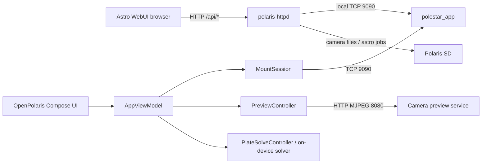

# Astro WebUI ↔ OpenPolaris parity matrix

Issue: [OpenPolaris #103](https://github.com/ian-morgan99/OpenPolaris/issues/103)
and the astronomy/capture portions of [#98](https://github.com/ian-morgan99/OpenPolaris/issues/98).

This is an evidence-backed source comparison, not a claim of hardware parity.
The Benro Polaris Patcher checkout was inspected read-only. No files, firmware,
issues, or hardware outside OpenPolaris were changed.

## Frozen provenance

| Item | Snapshot | Evidence |
|---|---|---|
| OpenPolaris | release candidate based on published `main` at `74169209f4807207bdc0e41fbbe23a083e907adc` | The isolated candidate worktree starts from the published main; the canonical local checkout is dirty and was not used as frozen package evidence. Final candidate SHA and release manifest are recorded at publication. |
| Astro WebUI source checkout | `/home/ian/Documents/VSCodeProjects/BenroPolarisPatcher`, branch `main`, HEAD `538ad73927883a24a48130d0dbbdb9db10f78017` | Source checkout was inspected read-only; it contains unrelated untracked `LMStudioLogEnhancements.md.rotated`, which was not edited. |
| WebUI client | `container/astro/webui/index.html`, `app.js`, `shutter.js`, `app.css` | Source-verified at the snapshot above; the last commit touching the WebUI is `6f64a1de7f227ee12401f8cc26edf1dfa55e34b9` (`webui(#273): auto-join toggle actually toggles, and the settings page can enter credentials`). |
| WebUI server | `container/astro/polaris-httpd.c` | Source-verified; embeds the WebUI assets and exposes the `/api/*` routes. |
| Astro package | `container/astro/embed_webui.py` plus the Astro build scripts | Source-verified; HTML/CSS/JS are gzip-embedded into the server binary for runtime independence. |
| Firmware/runtime boundary | `polestar_app` owns the mount control service on TCP 9090; the Astro WebUI control server is documented at TCP 8090 and the MJPEG preview remains a separate TCP 8080 service | Existing OpenPolaris handover and current patcher source evidence; exact firmware build and installed package hash remain required for a live claim. |

Evidence labels used below: **source** means the implementation was read;
**simulator** means OpenPolaris tests or a fake mount exercised it;
**hardware** means a version-bound physical observation; **gap** means the
capability is absent or not yet safe to advertise. A source match is not a
hardware qualification.

## Published package refresh (2026-11-11)

The source matrix below was originally frozen against an older OpenPolaris
commit. This section is the current package-level status for the published main
commit and must be read together with the source rows. It does not turn source
or simulator evidence into physical qualification.

| Area | Current release-candidate state based on `7416920` | Evidence class | Remaining boundary |
|---|---|---|---|
| Endpoint and route health | `EndpointKind`, `EndpointProfile`, `EndpointAddress`, `EndpointPhase` and independent control/preview service states are implemented in `EndpointHealth.kt`; the UI shows Direct AP, Home LAN, PC bridge and demo intent separately. | source + simulator | No live Home LAN lease, route or restart observation in this refresh. |
| Motion ownership and stop | `MotionSupervisor`, fast-jog ownership, shared STOP ALL and demo SLOW dead-man controls are wired through the common UI. Pointer cancellation, focus loss, competing direction arbitration and explicit recovery have deterministic tests. | source + simulator | No live motor command is enabled by the default build; physical stop/recovery and limits remain open. |
| SLOW and fine rate | `SlowMotionController`, `SlowMotionCapabilityRecord` and the source-aligned 532/533/534 formatter exist; `SlowMotionCapabilities.current` is immutable and unqualified, so runtime flags cannot manufacture live permission. | source + simulator | Exact firmware/gimbal/source-app identity, signs, units, acknowledgement, watchdog, physical stop, disconnect recovery and limit evidence are still missing. |
| Native camera capture | The capture phase machine separates request, busy, complete, failed and outcome-unknown; completion requires post-request lifecycle, non-empty file publication, and the terminal idle edge. | source + simulator | Named-camera and firmware physical M/B, file and recovery qualification remain open. |
| Astro WebUI shutter | `AstroWebUiCapture` and the ViewModel dispatch M/B and explicit B stop with bounded strict JSON acknowledgement; the shared capture gate still requires lifecycle, file, and terminal idle evidence. The current WebUI source uses `shutter.js` with 264 `c:-1` and reconciles asynchronous 264 state replies instead of treating POST success as a shot. | source + simulator | The resident WebUI control route, current 8090/8080 split, and same-firmware camera lifecycle still need supervised qualification. |
| Astro WebUI read-only parity | Typed clients now cover media, status, link, site, solve, run state, guide, autofocus, focal, limits, keep-Wi-Fi, Wi-Fi, target, session, programme and motion-programme source surfaces. Default-off flags protect writes and programme starts. | source + simulator | Live resident endpoint, response corpus and feature-by-feature installed runtime checks remain open. |
| Phone and PC shell | Compact phone graphics are 6 dp with 18 dp action footprints and 16 dp icon-only state tiles; summary-first Mission/Astro/Slow Motion/camera surfaces, dense Tonight cards, compact callout chrome, and bounded gallery/SD-file lists reduce scrolling while retaining disclosures and semantic action names. Responsive Astro actions keep full-width layout only on desktop. | source + package build | No physical phone screenshot or touch/rotation observation was performed in this refresh. |
| Release artifact | The prior rolling Android APK for `7416920` is signed and tag `latest` points to that commit; this candidate adds session-safe 263 video state handling and the compact-density refinement before the next rolling publish. | package + signature verifier | The next rolling workflow must publish the final candidate SHA and authoritative APK sidecars. User phone installation and rendered interaction are still external acceptance evidence. |

### Gap ranking and WBS ownership

| Rank | Capability group | Decision | Next owner and evidence gate |
|---|---|---|---|
| P0 | Endpoint truth, capture state, source readback and safe UI state | Keep in the shared controllers and expose as truthful `READY`, `UNKNOWN`, `BLOCKED`, `FAILED` or `OUTCOME_UNKNOWN` states. | WBS-02, WBS-04 and WBS-05; JVM replay plus named endpoint/camera evidence. |
| P1 | Mobile and PC presentation, gallery review and Astro read-only inspection | Continue app-only work behind the existing typed clients; preserve one session owner and bounded media/export policy. | WBS-01, WBS-07 and WBS-09; Compose contracts, desktop package and installed-phone review. |
| P2 | Astro session, tracking, guide, autofocus, site save and programme controls | Keep readback visible; enable writes only per capability flag after positive acknowledgement, cancellation and recovery contracts are proven. | WBS-05 and WBS-06; source payload tests, simulator state machines and exact resident response fixtures. |
| P3 | Native and Astro M/B, video, focus and file lifecycle | Do not broaden release paths or add fallback retries. Correlate request, lifecycle, file and idle state on a named camera/firmware pair. | WBS-04; issues #60, #81, #96, #99 and #100; supervised physical evidence required. |
| P4 | SLOW manual motion and fine-rate correction | Continue planner, simulator and UX work, but keep live transport unavailable until every capability-record blocker is evidenced. | WBS-03; issues #98 and #103; exact binary/source provenance plus physical stop and limit tests required. |
| External | Station Wi-Fi configuration and Alpaca/INDI/LX200 server interoperability | Keep these as explicit external adapters, not hidden prerequisites for the native client. | Issue #102 and later bridge work; network/process ownership and protocol tests required. |

### Current release verification

The published package was backed by these local checks on the isolated main
worktree before push:

```text
./gradlew :shared:jvmTest :composeApp:jvmTest --console=plain --no-daemon
ANDROID_HOME=/home/ian/android-sdk ANDROID_SDK_ROOT=/home/ian/android-sdk ./gradlew :composeApp:compileDebugKotlinAndroid --console=plain --no-daemon
./gradlew :desktopApp:createDistributable --console=plain --no-daemon
./gradlew :composeApp:jvmTest --tests dev.openpolaris.ui.MobileCompactControlsContractTest --tests dev.openpolaris.ui.MobileCompactDensityContractTest --tests dev.openpolaris.ui.MobileResponsiveLayoutContractTest --console=plain --no-daemon
```

These checks prove source/package readiness only. They do not prove live mount,
Bluetooth, camera, Astro WebUI, physical SLOW or installed-phone behavior.

## Data-flow comparison



The important boundary is that the Astro WebUI is a mount-resident HTTP
application, whereas OpenPolaris is a client of the mount control protocol.
Copying `/api/*` routes into OpenPolaris would create a second, version-sensitive
control plane. The preferred integration is to reuse stable protocol contracts
through OpenPolaris controllers and retain a small, explicitly versioned WebUI
adapter only where the WebUI provides a capability that has no safe protocol
equivalent.

## Function-by-function matrix

| WebUI screen/action | Source file/function/route | Firmware dependency/API/protocol | Current OpenPolaris screen/controller/function | Gap status | Proposed integration | Platforms | Priority | Evidence/provenance | Verification |
|---|---|---|---|---|---|---|---|---|---|
| Control-link status, opcode cache, health counters | `app.js`: `poll`, `render`, `paintLink`, `paintLinkStats`; `polaris-httpd.c`: `/api/link` | Resident link to 9090; cached opcode slots and link statistics | `MountSession`, `MountState`, `AppViewModel.statusMessage` | Partial | Add a typed connection-health model with endpoint, phase, age, and last error; keep one socket owner | JVM/Desktop/Android/iOS | P0/P1 | Source; OpenPolaris session tests | Fake link with connect, drop, stale, and reconnect cases; live endpoint test later |
| Pan/tilt/rotation joystick and keyboard jog | `app.js`: `wireSticks`, `wireJog`, `moveAxis`, `startHold`; `/api/move`, `/api/stop` | Server-side 400 ms lease, 50 ms repeat, dead-man stop; motion opcodes | `JogPane`, `TrackingController`, `AppViewModel.jog` | Partial | Preserve/extend the OpenPolaris motion supervisor; import the lease/dead-man semantics only after protocol evidence is versioned | All client platforms | P1/P2 | Source; motion safety comments in `polaris-jog.h` | Simulator lease expiry, pointer cancellation, STOP precedence; operator-gated hardware |
| Emergency stop | `app.js`: `stopEverything`; `/api/stop` | Stop command and server-side lease expiry | Existing disconnect/cancel paths; no single WebUI-equivalent stop surface in the basic pane | Partial | Add a common stop owner that pre-empts jog, GoTo, tracking, alignment, and fine-rate work | All | P1/P2 | Source; OpenPolaris WBS P2.5 | Fake competing operations and assert stop ordering; hardware qualification required |
| Live preview on/off | `app.js`: `setLive`; 291/292; direct `:8080/?action=stream` | 291 SET, 292 GET, separate MJPEG service on 8080 | `PreviewPane`, `PreviewController`, `AppViewModel.enterPreview/leavePreview` | Implemented, unqualified per camera | Keep control port and preview port separate; add explicit endpoint health and empty-stream terminal state | All where preview transport exists | P3 | Source; OpenPolaris #74/#80/#61 evidence | Preview contract tests; camera/model/firmware matrix still open |
| Framing grid, focus peaking, histogram, fullscreen/size | `app.js`: `wireStage`, `wireOverlays`, `analyseFrame`; `/api/snapshot` | Same-origin snapshot for pixel analysis; browser canvas | `PreviewPane` renders local grid/centre overlays, bounded luminance histogram and sampled focus-peaking map over the same decoded frame, plus fullscreen presentation | Implemented as local presentation aid | Keep analysis presentation-only; never infer focus, shutter or camera state from the overlay | Desktop/Android/iOS | P5 | Source; OpenPolaris preview pixel-analysis contract | JVM fixture tests and Compose preview contracts; no hardware dependency for overlays |
| Camera identity, battery, card status, mount pose | `app.js`: `paintStatus`, `paintMount`; 286/778/775/518/284 | Firmware telemetry and camera attachment | `CameraPane`, `AppViewModel.cameraAttachment`, battery/SD/device fields | Mostly implemented | Consolidate telemetry age/unknown rendering and expose the same safe status set in a capability registry | All | P0/P3 | Source; OpenPolaris post-connect burst | Simulator response fixtures; live model matrix |
| Camera exposure option reads | `app.js`: `fetchExposure`, `parseOptions`; 268/275/265/267/266 | Camera-provided option lists; indices are body-specific | `CameraController`, `CameraPane`, `AppViewModel.refreshCamera` | Implemented but qualification-gated | Keep dynamic option lists and the explicit qualification gate; do not advertise unsupported fields | All | P3 | Source; Benro Connect-derived `Codes.BenroCamera`; K-1 II/K-3 III evidence | Existing controller tests plus camera-specific physical matrix |
| Camera exposure writes and read-back | `app.js`: `wireExposure`, `reconcileExposure`; 261/276/258/260/259 | Explicit `ret`, delayed replies, `-2110` retry/read-back behavior | `CameraController.qualifyBenroSetting`, `AppViewModel.setIso/setWb/setFNum/setEv` | Stronger client contract exists; UI remains gated | Reuse per-field verification and surface retry/timeout states consistently | All | P3 | Source; WebUI commit `f593d918`; OpenPolaris camera contract tests | Fake delayed/rejected replies; version-bound camera tests |
| Single still capture | `app.js` + `shutter.js`: `wireShutter`, `reconcileShot`; current ordinary start is 264 `state:1;bulb:0;c:-1;`, and the HTTP response is queue-only | Camera record-status path; `/api/link/send` supplies subtype 2; asynchronous 264 state replies are reconciled in the browser | `CameraController.capture`, `AppViewModel.capture`; direct 264 subtype 4, `state:1;bulb:0;c:-1;` | Source payload and queue/completion distinction now match the source review, but route ownership and camera lifecycle are not interchangeable | Preserve OpenPolaris' separately live-qualified subtype-4 direct route until exact same-firmware A/B evidence proves subtype 2 is safe; never auto-fallback after an ambiguous shot | All | P3 | Benro Connect decompile; current Astro source at `6f64a1de`; OpenPolaris K-3 III trace; #60/#81 | One request, correlated 264 lifecycle, non-empty 773 path, terminal idle; hardware required |
| Video record toggle | `app.js` + `shutter.js`: `wireShutter`; 263 | Camera video-record status; POST/command acknowledgement is not recording proof | Camera pane has source-aligned 263 start/stop with a single-flight session owner, pending state, and unknown outcome on timeout | Implemented in source/package, unqualified on hardware | Keep the command gate and unknown-state quarantine; add file/recording evidence only after 263 semantics are version-bound | All | P3 | Current Astro source; issue #81; OpenPolaris controller/test evidence | Golden wire tests, then named-camera matrix and physical record/file observation |
| Timed Bulb and explicit stop | `app.js`: capture controls plus 264 policy; server-side programme paths | 264 state/bulb/c; camera owns exposure duration; stop/reconcile semantics vary | `CameraController.captureBulb/stopBulb`, `AppViewModel.captureBulb/stopBulb` | Implemented with stricter safety, not fully qualified | Keep preflight, explicit stop, bounded watchdog, and `OutcomeUnknown`; never add a competing 299 write without evidence | All | P3 | Source; OpenPolaris issue #96/#99 and capture tests | Bulb start/stop/file lifecycle on named camera + firmware; no unattended test |
| Gallery/filter/thumb/full download | `app.js`: `galleryLoad`, `galRenderGrid`, `galOpen`; `/api/media/list`, `/thumb`, `/full` | SD media directories and safe path resolver | `FilesPane`, `FileList`, file download flow | Partial | Add typed media categories and safe thumbnail/full-frame publication; no unrestricted SD path access | Desktop/Android/iOS | P3/P5 | Source | Path traversal tests, transfer integrity tests, hardware card test |
| Timelapse | `app.js`: `armLapse`, `paintProg`; `/api/prog/lapse` | Head-resident 272 programme, persistent progress | `IntervalometerController`, `AppViewModel.startSequence` | Partial | Keep client sequence's per-shot 264+773 evidence; add a separate head-program adapter only if 272 completion/file semantics are verified | All | P5 | Source; OpenPolaris intervalometer tests | Simulator pause/resume/stop; live programme evidence |
| Panorama | `app.js`: `armPano`, `renderPanoGrid`; `/api/prog/pano` | Head-resident 271/related camera workflow | No equivalent | Gap | Add as a capability-gated state machine after the full capture/file contract is known | All | P3/P5 | Source; issue #85 | No motor/shutter CI; operator-gated hardware plan |
| HDR | `app.js`: `armHdr`; `/api/prog/hdr` | Head-resident 280 workflow | No equivalent | Gap | First inventory 280 payload, exposure ownership, and resulting file set | All | P3/P5 | Source; issue #84 | Trace replay then hardware |
| Focus stack | `app.js`: `wireFocusRack`; `/api/prog/focus` | 311 focus adjustment plus 272/sequence ownership | Manual focus controls exist through `CameraController`; no stack workflow | Partial | Reuse verified near/far sign and focus ownership; add stack planner only with stop/recovery | All | P3/P5 | Source; OpenPolaris #77 focus contract | Simulator sequence; physical lens-direction test |
| Free programme / PLC keyframes | `app.js`: `wirePlc`; `/api/prog/plc/*` | Pose capture plus 283 programme | No equivalent | Gap | Model as a resumable motion/capture programme behind the motion supervisor | All | P2/P5 | Source | Deterministic simulator first; hardware clearance gate |
| Path-lapse | `app.js`: `wirePathlapse`; `/api/prog/pathlapse/*` | 283/272 path sequence and pose keyframes | No equivalent | Gap | Fold into a common observation-plan engine after PLC semantics are verified | All | P5 | Source | Simulator only until operator plan exists |
| Sun interval / Holy Grail | `app.js`: `wireSun`, `wireGrail`; `/api/prog/sun`, `/api/prog/grail/*` | Time-dependent head programmes, shutter and tracking | No equivalent | Gap | Do not import as generic timelapse; define solar safety, exposure, and recovery contracts first | All | P5/Safety | Source | Review plus hardware plan; no unattended Bulb |
| Astro session enter/leave, tilt compensation, dither | `app.js`: `wireAstro`; `/api/astro/enter`, `/leave`, 537/538/539/540 | Mode 8, AHRS/tilt and tracking flags | `AppViewModel.enableAhrs`, tracking, alignment helpers | Partial | Reuse OpenPolaris AHRS/tracking lifecycle; add explicit session ownership and capability status | All | P2/P4 | Source; OpenPolaris protocol docs | Simulator state machine; physical AHRS evidence |
| Phone compass/manual alignment | `app.js`: `readPhoneCompass`; `/api/astro/align` | Browser orientation permission or manual heading | `AlignmentController`, `GotoPane` | Partial | Add platform sensor adapter only where permission and calibration semantics are explicit | Android/iOS/Desktop manual | P4 | Source; existing alignment code | Sensor fixtures, then operator alignment |
| Plate solve and apply | `app.js`: `/api/solve`, `/api/state`; server solver jobs | Captured frame, focal hint, star catalogue, alignment write | `PlateSolveController`, `AppViewModel.solveNow`, `OnDevicePlateSolver` | Implemented in a different architecture; end-to-end gap | Keep pluggable offline solver and make capture/transfer/solve/apply stages separately observable | JVM/Desktop/Android first | P4 | Source; OpenPolaris solver tests; external source | Fixture/JPEG solver tests; measured camera loop later |
| Astro go-to | `app.js`: `/api/astro/goto` | Site location, solver/alignment state, bounded slew | `AppViewModel.goto`, `GoToController` | Implemented, qualification incomplete | Add solve-and-centre as an optional closed loop; preserve manual go-to | All | P4 | Source; OpenPolaris GoTo tests | Simulator convergence and safe cancellation; hardware residuals |
| Tracking and guiding | `app.js`: `/api/astro/track`, `/api/guide` | 284 tracking, AHRS, guide process, solved target | `TrackingController`, `AppViewModel.startTracking/stopTracking` | Partial | Keep tracking ownership in OpenPolaris; expose guide only after rate/motion contract is versioned | All | P2/P4 | Source; existing tracking-rate design | Simulator lease and rate tests; physical drift evidence |
| Astro autofocus | `app.js`: `/api/astro/autofocus` | 311 focus sweep, frame scoring, background job | No equivalent auto-focus workflow | Gap | Reuse focus adapter and add a bounded autofocus controller with cancel/terminal states | Desktop/Android first | P3/P4 | Source | Fixture scoring and cancellation; physical lens test |
| Site location | `app.js`: `siteLoad`, `wireSite`; `/api/site` | Persisted device-side `site.conf` | `AppViewModel.latDeg/lngEastDeg`, `TonightPane` and GoTo inputs | Partial | Persist validated location in OpenPolaris session/settings, separate from mount connection marker | All | P4 | Source; OpenPolaris AstroMath | Pure validation/math tests; no hardware dependency |
| Travel limits / dangerous release | `app.js`: `headSettingsRefresh`; `/api/astro/limits` | 541/542, physical attestation | No matching general UI surface | Gap, safety-sensitive | Add only as an explicit physical-attestation capability; never expose through a generic send button | All | Safety/P2 | Source | Simulator policy tests; physical clearance required |
| Keep-Wi-Fi-alive | `app.js`: `/api/keepwifi` | Resident helper holds a counted 9090 client; alignment gate | OpenPolaris has bridge/wake/teardown and persistent session owner work | Partial | Keep ownership in one app/session; do not add an idle socket without proving its lifecycle and battery cost | Desktop first | P1 | Source; existing OpenPolaris wake/bridge evidence | Fake disconnect/reconnect; live battery/network qualification |
| Configure station Wi-Fi while retaining AP | `app.js`: `/api/wifi`; `polaris-apsta.sh`, `polaris-autojoin.sh` | AP+station interface, same-channel constraint, DHCP, watchdog | OpenPolaris can connect to a user-supplied host and has host-side bridge helpers; it does not configure mount station Wi-Fi | External dependency / gap | Keep mount configuration out of OpenPolaris; support a typed Home-LAN endpoint and diagnostics, with Direct-AP fallback | All | P1 | Source; issue #102; patcher source is read-only reference | Requires exact station IP, 9090 control, 8090 WebUI and 8080 preview probes, bind/process evidence |
| WebUI/Alpaca/INDI/LX200 interoperability | `polaris-httpd.c`: HTTP, Alpaca, INDI, LX200 listeners | 8090/10001/7624 and UDP 32227; preview is separate on 8080 | No equivalent server role | Gap / optional adapter | Treat as an external integration target, not a replacement for the native client protocol | Desktop first | P6 | Source | Protocol contract tests; external clients later |

## Capture decision

The source review changes the reliability finding for the Astro WebUI. The
stock Benro Connect decompilation defines
`SP_SET_PHOTO_RECORD_STATUS(String state, String bulb, String c)` as:

```text
sendOrder(264, 2, "state:" + state + ";bulb:" + bulb + ";c:" + c + ";")
```

Its ordinary capture call sites use `state:1;bulb:0;c:-1;`. The only observed
stock-app use of `c:0` is the continuation-shooting stop branch in
`MainActivity.clickStop`; it is not the ordinary single-shot value.
The current Astro WebUI source has corrected the ordinary start payload: its
`shutter.js` sends `state:1;bulb:0;c:-1;`, matching the Benro Connect ordinary
capture form. It still has to reconcile the asynchronous camera lifecycle.

The WebUI server confirms that 264 is sent with subtype 2, but
`/api/link/send` still calls `plink_send()` and returns after the frame is
written or queued; it does not wait for the camera reply. The browser now
reconciles opcode 264 state replies, but a source-level match still proves
neither the 773 file publication nor transfer completion. Astro source also
warns that externally initiated capture may be ignored while Astro mode owns
the shutter.

OpenPolaris currently has the stronger completion contract: one guarded request,
no automatic retry, post-request 264 lifecycle correlation, non-empty 773 file
evidence, and terminal idle. Its normal single-shot route remains the direct
subtype-4 path because that exact frame has a retained K-3 III end-to-end trace;
its Bulb/stop path already uses the source-compatible subtype-2 form with
`c:-1`. This is a real route difference, not permission to send both forms:
trying subtype 2 after a subtype-4 timeout could double-fire a shutter whose
completion event was merely delayed.

The safe source-derived correction is therefore:

1. Keep the source-compatible ordinary form `1&264&2&state:1;bulb:0;c:-1;#`;
   the current WebUI source already does this, while older packaged builds did not.
2. Do not use the WebUI HTTP `ok:true` response as capture or file completion.
3. Keep OpenPolaris' no-retry evidence contract and do not change its
   live-qualified subtype-4 path until an exact camera/firmware A/B trace proves
   that subtype 2 is the safer direct route.

A live same-firmware comparison remains required before changing the OpenPolaris
normal-capture subtype. The current source evidence supports the WebUI's
`c:-1` payload and asynchronous reconciliation, but not universal
interchangeability of subtype 2 and subtype 4 or the 8090/8080 runtime boundary.

## First safe work slices

1. Add a typed endpoint/mode model for Direct AP versus Home-LAN connections,
   without changing NetworkManager, firmware, or hardware state.
2. Extend the connection contract with separate control `9090`, WebUI `8090`,
   and preview `8080` health results and actionable refusal/timeout diagnostics.
3. Keep the existing capture state machine as the portable contract; add a
   replay fixture for the Astro 264/272 observations and explicitly classify
   programme progress versus final file publication.
4. Inventory the remaining WebUI programmes behind capability flags and
   simulator contracts before adding any shutter or motor implementation.

## Acceptance evidence matrix

| Claim | Minimum evidence | Current status |
|---|---|---|
| OpenPolaris builds and unit tests pass | Required JVM/KMP test command and clean diff | The isolated release-candidate matrix passed shared/Compose JVM tests, Kotlin/JVM compilation, Android debug compilation and desktop packaging from `7416920`; the canonical checkout remains intentionally dirty and is excluded from this package claim. |
| Native capture is complete | 264 lifecycle correlated to a new non-empty 773 path, with camera/firmware versions | Simulator tests exist; physical qualification remains open. |
| Home-LAN control works | Station lease, route, `9090` TCP connect, non-destructive handshake, reconnect after DHCP/restart | Typed failure diagnostics are implemented and package-tested; station lease, routing and physical reconnect remain untested. |
| Astro WebUI feature is portable | Source route plus stable firmware/protocol contract and simulator replay | Typed read-only clients and simulator contracts cover many surfaces; resident endpoint and feature-by-feature installed-runtime evidence remain open. |
| Motor/limit/autofocus feature is safe | Explicit confirmation, cancel/stop, bounded timeout, physical clearance plan | Not claimed. |

## Existing issue ownership

- #102 owns station-LAN connection refusal and endpoint diagnostics.
- #103 owns this source comparison and parity roadmap.
- #60, #81, #90, #96, #99, and #100 remain authoritative for the existing
  OpenPolaris capture/Bulb lifecycle and must not be duplicated here.
- #98 remains the programme-level WBS and acceptance gate.
